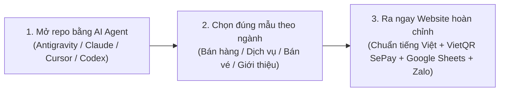

# 🚀 AGS-Salepages — Bộ Skill & Template Xây Dựng Website, Landing Page & Trang Bán Hàng Đa Ngành Việt Nam

> **Trích xuất từ bộ công cụ kinh doanh thực chiến [Agent Business System OS (ABS OS KIT)](https://agentsea.vn)**  
> **Phát triển bởi:** **AgentSea (`agentsea.vn`)** · **Canary ID:** `CANARY-AGS-SALEPAGES-V1`

### ❌ Vấn đề khi bạn tự bảo AI làm trang web bán hàng:
- Giao diện nhìn một màu "mùi AI" (nền tím nhạt, font chữ lỗi dấu tiếng Việt, bố cục rời rạc không giống trang bán hàng thật).
- Chữ viết chung chung, sáo rỗng, khách đọc xong không hiểu bạn bán gì và tại sao phải mua ngay.
- Không có luồng thu tiền thực tế tại Việt Nam: thiếu mã quét **VietQR**, không nối được **Google Sheets** quản lý đơn, thiếu nút đẩy khách về **Zalo** chốt sale.

### ✅ Kết quả bạn nhận được ngay với `ags-salepages`:
Chỉ cần mở bộ repo này bằng **Antigravity, Claude Code, Cursor hoặc Codex**, bạn có ngay một trang web hoàn chỉnh để gửi link cho khách trong 5 phút:



1. **Đa dạng mẫu trang cho mọi nhu cầu kinh doanh tại Việt Nam:**
   - Làm **trang bán sản phẩm vật lý (COD / Flash Sale)**, **trang đặt lịch dịch vụ (Spa, Nha khoa, Phòng khám, Resort)**, **trang bán vé sự kiện / giải chạy bộ 0đ phí sàn**, **trang bán khóa học / phần mềm**, đến **trang giới thiệu doanh nghiệp, Showroom & thu thập thông tin khách hàng (Lead)**.
2. **Giao diện đẹp, sạch, chuẩn thẩm mỹ thương mại (Zero AI-Slop):**
   - Cấm tuyệt đối màu tím AI (`#6366f1`) và font lỗi dấu. Dùng sẵn bộ 3 font tiếng Việt sắc nét (`Bricolage Grotesque`, `Be Vietnam Pro`, `JetBrains Mono`) và hệ màu tương phản cao giúp khách dễ đọc trên điện thoại.
3. **Nội dung viết thẳng vào vấn đề của người mua:**
   - Sắp xếp sẵn bố cục thuyết phục khách hàng: Nêu đúng kết quả khách cần $\rightarrow$ Chạm đúng nỗi đau thực tế $\rightarrow$ Đưa ra gói ưu đãi & quà tặng hấp dẫn $\rightarrow$ Giải đáp sẵn các câu khách hay lăn tăn về giá $\rightarrow$ Kêu gọi hành động rõ ràng.
4. **Thu tiền & Quản lý khách hàng tự động (0 đồng chi phí thuê server):**
   - Tích hợp sẵn mã **VietQR tự động theo đơn**, nút bấm mở thẳng **Zalo tư vấn**, và file script nối **Google Sheets + SePay** để khách chuyển khoản xong là tự động nhảy trạng thái *"Đã thanh toán"* và gửi vé/xác nhận qua Email!
---

## 📦 Danh Mục 6 Bộ Template Thực Chiến Có Sẵn (`templates/`)

| STT | Thư mục Template | Mô hình kinh doanh phù hợp | Điểm ăn tiền nhất |
|---|---|---|---|
| **01** | [`01-event-ticketing-sepay`](./templates/01-event-ticketing-sepay/) | **Giải chạy bộ (Marathon/Trail/Fun Run), Giải Pickleball, Bán vé Workshop, Sự kiện, Tiệc tất niên** | **Bán vé 0đ phí sàn:** Chọn cự ly/hạng vé, chọn size áo, tự tạo VietQR theo cú pháp, kèm file `google-apps-script-sepay.gs` tự khớp lệnh SePay vào Google Sheets và cấp số BIB / vé QR tự động! |
| **02** | [`02-vsl-conversion-funnel`](./templates/02-vsl-conversion-funnel/) | **Khóa học Online, Coaching 1-1, Phần mềm SaaS, Dịch vụ AI, Sản phẩm số** | Khung Video VSL 16:9 tập trung 100% sự chú ý, kèm máy tạo kịch bản VSL 4 nhịp và bảng Value Stack cộng dồn giá trị quà tặng. |
| **03** | [`03-longform-sales-letter`](./templates/03-longform-sales-letter/) | **Dịch vụ High-Ticket, Tư vấn doanh nghiệp, Bất động sản, Giải pháp B2B** | Đủ **8 Khối Bán Hàng Bất Biến** của ABS OS: Tiêu đề kết quả $\rightarrow$ 3 nỗi đau có giờ giấc $\rightarrow$ Cơ chế riêng $\rightarrow$ Lợi ích $\rightarrow$ Giá $\rightarrow$ Đối thoại 3 câu chê–đáp $\rightarrow$ Cam kết $\rightarrow$ CTA. |
| **04** | [`04-spa-clinic-resort-booking`](./templates/04-spa-clinic-resort-booking/) | **Spa, Thẩm mỹ viện, Nha khoa, Phòng khám, Resort, Homestay, F&B** | Phong cách Editorial sang trọng, bảng giá dịch vụ minh bạch, chọn khung giờ đặt lịch giữ chỗ đẩy thẳng về Zalo tư vấn viên. |
| **05** | [`05-ecom-flash-sale-cod`](./templates/05-ecom-flash-sale-cod/) | **Sản phẩm vật lý, Thời trang, Mỹ phẩm, Đồ gia dụng, Quà tặng, Đặc sản** | Tối ưu 100% cho khách lướt điện thoại: Chọn Combo mua 2 tặng 1, đếm ngược ưu đãi, hỗ trợ cả điền địa chỉ Ship COD lẫn quét VietQR giảm thêm tiền. |
| **06** | [`06-showroom-portfolio-lead`](./templates/06-showroom-portfolio-lead/) | **Showroom Nội thất/Ô tô, Studio Sáng tạo, Chuyên gia/Freelancer, Tặng Ebook/Quà thu Lead** | Bố cục trưng bày cao cấp (Clean-Room Gallery), khóa nội dung nhận quà (Lead Magnet Gate) để thu thập Họ tên + SĐT Zalo + Email khách hàng tiềm năng. |

---

## ⚡ Cách Sử Dụng Trong 3 Bước (Không Cần Biết Code)

### Bước 1: Mở thư mục này bằng AI Coding Agent của bạn
- Mở bằng **Google Antigravity**, **Claude Code**, **Cursor**, hoặc **OpenAI Codex**.
- Hoặc nếu máy bạn có cài sẵn Node.js ($\ge 20$), bạn có thể chạy lệnh dòng lệnh:
  ```bash
  npm run wizard
  ```

### Bước 2: Nhắn yêu cầu của bạn cho AI
Chỉ cần gõ vào khung chat của AI sản phẩm bạn đang bán, hoặc gõ:
> **"Đọc `HUONG-DAN-CHO-TRO-LY-AI.md` và dựng giúp tôi một trang bán hàng / giới thiệu dịch vụ cho [tên sản phẩm/dịch vụ của bạn]."**

AI sẽ chọn đúng mẫu trang hợp nhất với ngành của bạn, hỏi thêm vài thông tin cơ bản (giá bán, quyền lợi khách nhận được, số tài khoản VietQR / số Zalo) rồi xuất ngay ra trang web hoàn chỉnh!

### Bước 3: Kiểm tra & Đưa lên mạng miễn phí
- Mở trực tiếp file `.html` vừa tạo bằng trình duyệt (Chrome/Safari) để xem ngay.
- Đưa lên mạng miễn phí trong 30 giây bằng cách kéo thả thư mục vào **Cloudflare Pages** hoặc **Vercel**.

---

## 💎 Bạn Muốn Đi Xa Hơn Một Trang Bán Hàng? (Mở Khóa Hệ Sinh Thái AgentSea)

Trang bán hàng (`ags-salepages`) chỉ là **1 trong 14 động cơ** của hệ điều hành kinh doanh tự động **Agent Business System (ABS OS)**.

Sau khi có trang bán hàng đẹp, doanh nghiệp của bạn sẽ cần giải quyết 3 bài toán lớn hơn:
1. **Làm sao kéo hàng ngàn khách hàng tiềm năng vào trang mỗi ngày?** (Content Factory, Video Reels AI, Facebook Lead Radar).
2. **Khách nhắn tin Zalo lúc 11 giờ đêm thì ai trả lời và chốt đơn?** (AGS Zalo OS — Trợ lý AI trực Zalo 24/7, quản lý đa tài khoản, chống sót đơn).
3. **Làm sao tự động gửi chuỗi Email chăm sóc để khách mua đi mua lại?** (Follow-up Engine & Email Closer).

👉 **Tham gia cộng đồng & Nhận trọn bộ vũ khí AI thực chiến tại:**
- 🌐 **Website chính thức:** [https://agentsea.vn](https://agentsea.vn)
- 🏕️ **Trại huấn luyện thực chiến SoloBiz Camp & ABS OS KIT:** Nơi hướng dẫn chủ doanh nghiệp và Solopreneur xây dựng cỗ máy bán hàng tự động bằng AI từ con số 0 đến khi ra đơn thật.

---

## 🛡️ Bản Quyền & Chính Sách Sử Dụng (7-Layer Anti-REA Seal)

Kho lưu trữ này được phát hành theo giấy phép **AGS Source-Available & Anti-Clone License v1.0** (xem chi tiết tại [`LICENSE`](./LICENSE) và [`NOTICE`](./NOTICE)):
- **Được phép:** Fork trực tiếp từ `https://github.com/teddiesloco/ags-salepages` và sử dụng để tạo trang bán hàng cho doanh nghiệp/cửa hàng của bạn hoặc khách hàng của bạn.
- **Nghiêm cấm:** Sao chép tạo repo mới không qua Fork chính thống (debrand/nhận vơ), xóa dấu vân tay bản quyền của AgentSea, dùng AI để Reverse-Engineer (REA), hoặc đóng gói bộ công cụ này để đem bán thương mại dưới tên khác.
- Kiểm tra tính toàn vẹn của bản gốc bất kỳ lúc nào bằng lệnh:
  ```bash
  npm test
  ```
