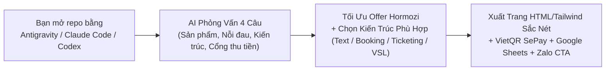

# 🚀 AGS-Salepages — Cỗ Máy AI Phỏng Vấn Offer, Viết VSL & Dựng Trang Bán Hàng Đa Ngành Việt Nam

> **Một phần tinh hoa trích xuất từ hệ điều hành kinh doanh [Agent Business System OS (ABS OS KIT)](https://agentsea.vn)**  
> **Phát triển bởi:** **AgentSea (`agentsea.vn`)** · **Canary ID:** `CANARY-AGS-SALEPAGES-V1`

Bạn mở Claude Code, Antigravity, Cursor hay Codex lên bảo *"làm cho tôi cái landing page"* và nhận về một trang web nền tím nhợt nhạt, chữ viết sáo rỗng kiểu dịch máy, không có nổi một nút quét mã VietQR hay luồng chốt đơn thực tế?

**`ags-salepages`** giải quyết triệt để vấn đề đó. Đây không chỉ là một kho giao diện tĩnh, mà là **một Giám đốc Chuyển đổi & Thiết kế AI được đóng gói sẵn**: Bạn chỉ cần bỏ thư mục này vào bất kỳ AI Coding Agent nào, AI sẽ **tự động phỏng vấn ngược bạn 4 câu hỏi**, tư vấn **Offer Không Thể Chối Từ (công thức Alex Hormozi)**, viết sẵn **Kịch bản Video Bán Hàng (VSL)** và xuất ra trang bán hàng hoàn chỉnh chuẩn tâm lý mua hàng của người Việt!

---

## ✨ 4 Vũ Khí Hạng Nặng Bên Trong `ags-salepages`



1. **AI Tự Động Phỏng Vấn & Đóng Gói Offer Không Thể Chối Từ:**
   - Không cần biết viết prompt dài dòng. AI tự hỏi bạn từng bước để đóng gói sản phẩm chính + quà tặng kèm + cam kết đảo ngược rủi ro + xử lý 3 lời từ chối phổ biến nhất của khách.
2. **6 Kiến Trúc Trang Bán Hàng Thực Chiến (Kèm 24 Route Gốc của ABS OS):**
   - Từ **Hệ thống bán vé giải chạy bộ / sự kiện 0% phí sàn (Landing Page + Google Sheets + SePay VietQR cấp mã BIB tự động)**, đến **Trang Video Bán Hàng (VSL)**, **Thư bán hàng chữ dài (Long-form 8 khối)**, **Trang Đặt lịch Spa/Nha khoa/Resort**, **Trang Flash Sale E-commerce**, và **Showroom/Portfolio thu Lead**.
3. **Chuẩn Thẩm Mỹ AgentSea (Zero AI-Slop):**
   - Tuyệt đối không dùng màu tím AI (`#6366f1`) hay font `Inter` nhàm chán. Sử dụng bộ 3 font chuẩn dấu tiếng Việt (`Bricolage Grotesque`, `Be Vietnam Pro`, `JetBrains Mono`) và hệ màu tương phản cao (`Paper #f4f4ef`, `Ink #0e1116`, `Signal Green #1f6f3d`, `Neon #a8ff3e`).
4. **Tích Hợp Sẵn Luồng Tiền & Quản Lý Đơn Hàng 0 Đồng Chi Phí Server:**
   - Nhúng sẵn bộ tạo mã **VietQR động**, nút mở thẳng **Zalo cá nhân / Zalo OA**, và toàn bộ mã nguồn **Google Apps Script (`google-apps-script-sepay.gs`)** để khách chuyển khoản xong là tự động nhảy trạng thái *"Đã thanh toán"* trong Google Sheets và gửi vé QR qua Email!

---

## 📦 Danh Mục 6 Bộ Template Thực Chiến Có Sẵn (`templates/`)

| STT | Thư mục Template | Mô hình kinh doanh phù hợp | Điểm ăn tiền nhất |
|---|---|---|---|
| **01** | [`01-event-ticketing-sepay`](./templates/01-event-ticketing-sepay/) | **Giải chạy bộ (Marathon/Trail/Fun Run), Giải Pickleball, Bán vé Workshop, Sự kiện, Tiệc tất niên** | **Bán vé 0đ phí sàn:** Chọn cự ly/hạng vé, chọn size áo, tự tạo VietQR theo cú pháp, kèm file `google-apps-script-sepay.gs` tự khớp lệnh SePay vào Google Sheets và cấp số BIB / vé QR tự động! |
| **02** | [`02-vsl-conversion-funnel`](./templates/02-vsl-conversion-funnel/) | **Khóa học Online, Coaching 1-1, Phần mềm SaaS, Dịch vụ AI, Sản phẩm số** | Khung Video VSL 16:9 tập trung 100% sự chú ý, kèm máy tạo kịch bản VSL 4 nhịp và bảng Value Stack cộng dồn giá trị quà tặng. |
| **03** | [`03-longform-sales-letter`](./templates/03-longform-sales-letter/) | **Dịch vụ High-Ticket, Tư vấn doanh nghiệp, Bất động sản, Giải pháp B2B** | Đủ **8 Khối Bán Hàng Bất Biến** của ABS OS: Tiêu đề kết quả $\rightarrow$ 3 nỗi đau có giờ giấc $\rightarrow$ Cơ chế riêng $\rightarrow$ Lợi ích $\rightarrow$ Giá $\rightarrow$ Đối thoại 3 câu chê–đáp $\rightarrow$ Cam kết $\rightarrow$ CTA. |
| **04** | [`04-spa-clinic-resort-booking`](./templates/04-spa-clinic-resort-booking/) | **Spa, Thẩm mỹ viện, Nha khoa, Phòng khám, Resort, Homestay, F&B** | Phong cách Editorial sang trọng, bảng giá dịch vụ minh bạch, chọn khung giờ đặt lịch giữ chỗ đẩy thẳng về Zalo tư vấn viên. |
| **05** | [`05-ecom-flash-sale-cod`](./templates/05-ecom-flash-sale-cod/) | **Sản phẩm vật lý, Thời trang, Mỹ phẩm, Đồ gia dụng, Quà tặng, Đặc sản** | Tối ưu 100% cho khách lướt điện thoại: Chọn Combo mua 2 tặng 1, đếm ngược ưu đãi, hỗ trợ cả điền địa chỉ Ship COD lẫn quét VietQR giảm thêm tiền. |
| **06** | [`06-showroom-portfolio-lead`](./templates/06-showroom-portfolio-lead/) | **Showroom Nội thất/Ô tô, Studio Sáng tạo, Chuyên gia/Freelancer, Tặng Ebook/Quà thu Lead** | Bố cục trưng bày cao cấp (Clean-Room Gallery), khóa nội dung nhận quà (Lead Magnet Gate) để thu thập Họ tên + SĐT Zalo + Email khách hàng tiềm năng. |

---

## ⚡ Cách Sử Dụng Trong 3 Bước (Không Cần Biết Code)

### Bước 1: Mở thư mục này bằng AI Coding Agent của bạn
- Mở bằng **Google Antigravity**, **Claude Code**, **Cursor**, hoặc **OpenAI Codex**.
- Hoặc nếu máy bạn có cài sẵn Node.js ($\ge 20$), bạn có thể chạy lệnh dòng lệnh:
  ```bash
  npm run wizard
  ```

### Bước 2: Gõ 1 câu duy nhất để AI bắt đầu phỏng vấn bạn
Hãy gõ vào khung chat của AI:
> **"Hãy đọc file `HUONG-DAN-CHO-TRO-LY-AI.md` và phỏng vấn tôi để làm một trang bán hàng chuyển đổi cao."**

AI sẽ hỏi bạn 4 câu cực dễ hiểu (Bạn bán gì? Khách sợ gì? Thích kiểu trang nào? Nhận tiền qua đâu?), sau đó tự động phân tích Offer, viết kịch bản video và xuất ra file web hoàn chỉnh cho bạn!

### Bước 3: Kiểm tra & Đưa lên mạng miễn phí
- Mở trực tiếp file `.html` vừa tạo bằng trình duyệt (Chrome/Safari) để xem ngay.
- Đưa lên mạng miễn phí trong 30 giây bằng cách kéo thả thư mục vào **Cloudflare Pages** hoặc **Vercel**.

---

## 💎 Bạn Muốn Đi Xa Hơn Một Trang Bán Hàng? (Mở Khóa Hệ Sinh Thái AgentSea)

Trang bán hàng (`ags-salepages`) chỉ là **1 trong 14 động cơ** của hệ điều hành kinh doanh tự động **Agent Business System (ABS OS)**.

Sau khi có trang bán hàng đẹp, doanh nghiệp của bạn sẽ cần giải quyết 3 bài toán lớn hơn:
1. **Làm sao kéo hàng ngàn khách hàng tiềm năng vào trang mỗi ngày?** (Content Factory, Video Reels AI, Facebook Lead Radar).
2. **Khách nhắn tin Zalo lúc 11 giờ đêm thì ai trả lời và chốt đơn?** (AGS Zalo OS — Trợ lý AI trực Zalo 24/7, quản lý đa tài khoản, chống sót đơn).
3. **Làm sao tự động gửi chuỗi Email chăm sóc để khách mua đi mua lại?** (Follow-up Engine & Email Closer).

👉 **Tham gia cộng đồng & Nhận trọn bộ vũ khí AI thực chiến tại:**
- 🌐 **Website chính thức:** [https://agentsea.vn](https://agentsea.vn)
- 🏕️ **Trại huấn luyện thực chiến SoloBiz Camp & ABS OS KIT:** Nơi hướng dẫn chủ doanh nghiệp và Solopreneur xây dựng cỗ máy bán hàng tự động bằng AI từ con số 0 đến khi ra đơn thật.

---

## 🛡️ Bản Quyền & Chính Sách Sử Dụng (7-Layer Anti-REA Seal)

Kho lưu trữ này được phát hành theo giấy phép **AGS Source-Available & Anti-Clone License v1.0** (xem chi tiết tại [`LICENSE`](./LICENSE) và [`NOTICE`](./NOTICE)):
- **Được phép:** Fork trực tiếp từ `https://github.com/teddiesloco/ags-salepages` và sử dụng để tạo trang bán hàng cho doanh nghiệp/cửa hàng của bạn hoặc khách hàng của bạn.
- **Nghiêm cấm:** Sao chép tạo repo mới không qua Fork chính thống (debrand/nhận vơ), xóa dấu vân tay bản quyền của AgentSea, dùng AI để Reverse-Engineer (REA), hoặc đóng gói bộ công cụ này để đem bán thương mại dưới tên khác.
- Kiểm tra tính toàn vẹn của bản gốc bất kỳ lúc nào bằng lệnh:
  ```bash
  npm test
  ```
