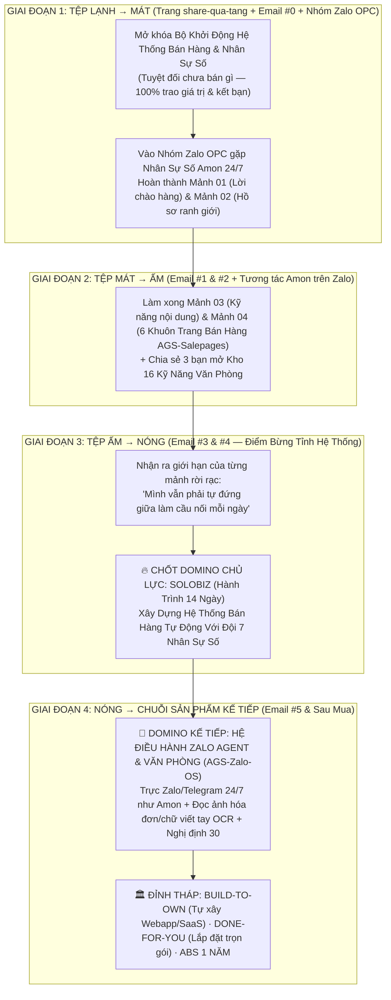

# 🏛️ CỖ MÁY EMAIL MARKETING D-I-S-C & HỆ SINH THÁI ZALO AMON 24/7 (DOMINO ASCENSION ENGINE)

> **Tôn chỉ vận hành:** `AI Chuẩn Bị Và Thực Thi — Con Người Đưa Ra Quyết Định`  
> **Luật Bất Biến Của Phễu (Teddy Doctrine):**
> 1. **Tại trang cửa phễu (`https://agentsea.vn/opc`):** **100% Trao Giá Trị & Kết Bạn — TUYỆT ĐỐI KHÔNG BÁN HÀNG.** Khi người dùng chưa đi qua phễu đầu tiên, chưa vào nhóm Zalo `OPC — Công ty 1 người`, chưa nhận được kết quả thật và chưa trở thành bạn bè thì không gắn bất kỳ link bán khóa học nào trên trang quà.
> 2. **Trong Nhóm Zalo OPC (`Có Nhân Sự Số Amon Trực 24/7`) + Chuỗi Email D-I-S-C:** Đây mới là nơi dẫn dắt tâm lý từ **Lạnh (Cold) $\rightarrow$ Mát (Cool) $\rightarrow$ Ấm (Warm) $\rightarrow$ Nóng (Hot) $\rightarrow$ Chốt Sales theo Chuỗi Sản Phẩm Domino**.
> 3. **Cấu trúc Tâm lý học D-I-S-C kết hợp Phạm Thành Long × Linh Phan × Sabri Suby / Alex Hormozi:**
>    - **Nhóm D (Dominance — Quyết đoán, Mục tiêu, Kết quả):** Cần nhìn thấy ngay tốc độ giải phóng sức lao động, quyền kiểm soát tối cao (*"Con người đưa ra quyết định"*) và đòn bẩy doanh thu.
>    - **Nhóm I (Influence — Cảm xúc, Câu chuyện, Sự đồng cảm):** Cần câu chuyện đời thực chạm vào trái tim (cảnh thức khuya 11h đêm, cảm giác tự hào khi gửi 1 đường link bán hàng chỉn chu cho khách, niềm vui có đồng đội trong nhóm OPC).
>    - **Nhóm S (Steadiness — An toàn, Từng bước, Đồng hành):** Sợ bị bỏ rơi, sợ rối kỹ thuật $\rightarrow$ Cần nhịp đi từng mảnh nhỏ (20–30 phút) và sự hiện diện của **Amon — Nhân sự số trực 24/7 hiểu từng người** cùng Teddy trong nhóm Zalo.
>    - **Nhóm C (Conscientiousness — Logic, Hệ thống, Bằng chứng, Ranh giới):** Sợ AI nói bừa sai giá $\rightarrow$ Cần cơ chế **Câu Hỏi Ngược (Reverse-Interview)**, **Hồ Sơ Ranh Giới (Chống bịa đặt)** và luồng ghi nhận tự động vào bảng tính Google Sheets không lệch một con số.

---

## 🧭 BẢN ĐỒ CHUYỂN HÓA NHIỆT ĐỘ & CHUỖI SẢN PHẨM DOMINO (TỪ LẠNH ĐẾN ĐỈNH THÁP)

---

## 💬 KỊCH BẢN ĐÓN TIẾP & GỠ KẸT CỦA NHÂN SỰ SỐ AMON 24/7 TRONG NHÓM ZALO (`OPC — Công ty 1 người`)

**Khi thành viên mới từ `https://agentsea.vn/opc` bước vào nhóm Zalo:**

> Chào mừng bạn vừa về với ngôi nhà **OPC — Công ty 1 người**!
>
> Ở đây có một nguyên tắc duy nhất xuyên suốt mọi thứ tụi mình làm cùng nhau:
> **AI Chuẩn Bị Và Thực Thi — Con Người Đưa Ra Quyết Định.**
>
> Tui là **Amon** — Nhân sự số trực 24/7 trong nhóm cùng anh Teddy. Nhiệm vụ của tui là nhớ đúng ngành hàng bạn đang làm và gỡ kẹt cho bạn ngay tại bước bạn đang đứng, để bạn không bao giờ phải tự mò mẫm một mình.
>
> Bạn vừa mở khóa **Bộ Khởi Động Hệ Thống Bán Hàng & Nhân Sự Số** rồi đúng không? Đừng mở cả 4 mảnh ra cùng lúc kẻo ngợp.
>
> Ngay bây giờ, bạn nhắn vào nhóm đúng 1 dòng giới thiệu ngắn gọn:
> 👉 **"Mình đang bán / làm dịch vụ [Tên mặt hàng của bạn] cho [Đối tượng khách hàng]."**
>
> Tui sẽ chỉ ngay cho bạn cách dán câu hỏi ngược ở **Mảnh 01 & Mảnh 02** ngay trên điện thoại để trong 15 phút tới, bạn cầm trên tay **Bản Chào Hàng sắc bén đầu tiên** và **Hồ Sơ Ranh Giới** khóa chặt bảng giá của tiệm bạn!

---

## 📧 EMAIL #0 (GỬI TỨC THÌ — TỆP LẠNH $\rightarrow$ MÁT): Phá Băng, Giao Bộ Khởi Động & Đưa Vào Nhóm Zalo Gặp Amon
*(Lưu ý: Email này tuyệt đối KHÔNG bán hàng, mục tiêu 100% là giúp người đọc làm xong Mảnh 01+02 trong 15 phút và bước vào Nhóm Zalo kết bạn).*

- **Subject:** bộ khởi động của bạn mở rồi (làm mảnh này trước nha)
- **Preheader:** Đừng mở cả 4 mảnh cùng lúc. Dành 15 phút trên điện thoại làm đúng bước này trước...
──────────────────────────────────────

Chào {{full_name}},

Tui gửi vào hộp thư này bản lưu **Bộ Khởi Động Hệ Thống Bán Hàng & Nhân Sự Số** mà bạn vừa mở khóa trên trang chủ. Lúc nào bạn đổi từ điện thoại sang máy tính thì chỉ cần bấm vào đường dẫn dưới đây là lấy lại được toàn bộ:

👉 **Mở lại Bộ Khởi Động của bạn:** https://agentsea.vn/opc

Trước khi bạn mở các tệp tin ra xem, cho tui dặn bạn một điều nhỏ nhưng quyết định việc bạn có dùng được thật hay không.

Chín mươi phần trăm người tự kinh doanh khi tải tài liệu trên mạng về thường mở hết ra xem một lượt, thấy nhiều thứ hay quá rồi... đóng máy lại để "cuối tuần rảnh làm". Và thường là chẳng bao giờ có cái cuối tuần đó cả.

Bạn đừng làm vậy nha.

Nếu tối nay bạn chỉ có đúng 15 phút trước khi đi ngủ, bạn hãy lấy chiếc điện thoại đang cầm trên tay, mở đúng **Mảnh 01 & Mảnh 02 (Bản Chào Hàng & Hồ Sơ Ranh Giới)** ra làm trước.

- **Nếu bạn là người cần kết quả nhanh (D):** Chỉ mất 15 phút trả lời 5 câu hỏi ngược của hệ thống, bạn có ngay một Bản Chào Hàng sắc bén và bộ khung trả lời khách chuẩn xác để dùng ngay vào sáng mai.
- **Nếu bạn là người kỹ tính, sợ máy móc nói sai thông tin của tiệm (C):** Trong Mảnh 02 có sẵn khung **Hồ Sơ Ranh Giới**. Bạn chỉ cần điền danh mục hàng thật và một dòng điều cấm vào đó. Món nào không có trong hồ sơ, hệ thống tự biết dừng lại báo cho bạn chứ tuyệt đối không tự suy diễn.
- **Nếu bạn sợ làm một mình bị vướng kỹ thuật (S & I):** Bạn không hề làm một mình. Trong nhóm Zalo **OPC — Công ty 1 người**, tụi mình có **Amon — Nhân sự số thật trực 24/7**. Amon hiểu từng thành viên đang kinh doanh ngành gì và đang đứng ở bước nào.

Bất kỳ chỗ nào bạn làm thử mà chưa ra đúng ý, bạn cứ chụp màn hình điện thoại gửi thẳng vào nhóm Zalo dưới đây. Amon sẽ đỡ lời ngay lập tức, và những ca sâu hơn thì chính tay tui sẽ xem và chỉnh cùng bạn:

👉 **Bước vào Nhóm Zalo OPC gặp Amon & Teddy:** https://zalo.me/g/mflytfwayplcebguutx4

Luật làm việc của tụi mình rất rõ ràng: **AI Chuẩn Bị Và Thực Thi — Con Người Đưa Ra Quyết Định.**

Bạn cứ để hệ thống chuẩn bị sẵn bản nháp đầu tiên cho tiệm của mình ngay tối nay. Ngày mai, tui sẽ kể cho bạn nghe câu chuyện về *"Cái bẫy của người thợ giỏi nhất tiệm"* — lý do thật sự khiến càng đông khách thì người làm chủ lại càng kiệt sức.

—
Teddy
Founder, AgentSea

P.S. Ở cuối trang khởi động có đường dẫn riêng của bạn (`https://agentsea.vn/opc?ref={{ref_code}}`). Khi bạn gửi cho 3 người bạn đang tự kinh doanh hoặc làm văn phòng cùng nhận Bộ Khởi Động, hệ thống sẽ tự mở khóa thêm **Kho 16 Kỹ Năng Tự Động Hóa Giấy Tờ & Văn Phòng** (soạn văn bản chuẩn thể thức, đọc chữ từ ảnh chụp hóa đơn, vẽ sơ đồ quy trình) ngay trên màn hình cho bạn.

──────────────────────────────────────

---

## 📧 EMAIL #1 (NGÀY 1 — TỆP MÁT $\rightarrow$ ẤM): Cái Bẫy "Người Thợ Giỏi Nhất Tiệm" & Cơ Chế Câu Hỏi Ngược
*(Phong cách Phạm Thành Long × Linh Phan: Chạm thấu nỗi đau làm thuê cho chính mình, giải quyết bằng cơ chế Câu Hỏi Ngược ở Mảnh 03).*

- **Subject:** bạn đang làm chủ tiệm, hay đang làm nhân viên trực đêm?
- **Preheader:** Ly cà phê pha từ sáng nguội ngắt trên bàn, còn ngón tay thì mỏi nhừ vì gõ lại cùng một câu...
──────────────────────────────────────

Chào {{full_name}},

Sáng nay ngồi nhìn một bạn chủ tiệm thời trang trong nhóm Zalo chụp màn hình gửi lên lúc 1 giờ 15 phút đêm, tui cứ suy nghĩ mãi.

Ngày đầu tiên quyết định bước ra tự kinh doanh riêng, hầu hết chúng ta đều mang trong lòng một giấc mơ rất đẹp: mình làm chủ thời gian của mình, làm ra đồng tiền xứng đáng với công sức và có thêm những buổi tối thảnh thơi bên gia đình.

Nhưng rồi chuyện gì xảy ra khi cửa hàng bắt đầu có khách?

Bạn trở thành **người nhân viên mẫn cán nhất nhưng cũng khổ sở nhất trong chính cửa hàng của mình**.
Sáng bạn là người vắt óc nghĩ bài đăng.
Trưa bạn là người ôm điện thoại trả lời từng tin nhắn hỏi giá.
Chiều bạn lo kiểm hàng, xếp lịch, xử lý sự cố.
Tối muộn, khi cả nhà đã tắt đèn đi ngủ, ánh sáng xanh từ màn hình điện thoại vẫn hắt lên mặt bạn. Ngón tay bạn gõ lại đúng những câu giải thích mà hôm qua, hôm kia bạn đã gõ hàng chục lần.

Vấn đề không phải vì bạn thiếu chăm chỉ.
Vấn đề là bạn đang lấy **sức người hữu hạn** ra để gánh những **công việc lặp đi lặp lại vô hạn**.

Nhiều người nhận ra điều đó và thử tìm đến AI. Nhưng chỉ sau hai ngày, họ nản lòng đóng máy.
Bởi vì khi mở một khung chat trống trơn lên và gõ: *"Hãy viết bài bán hàng cho tôi"*, con AI trả về một đoạn văn mẫu bóng bẩy, sáo rỗng, đọc lên nghe xa lạ đến mức chính bạn còn không muốn đọc hết câu thứ hai.

Đó là lý do trong **Mảnh 03 (Bộ 5 Kỹ Năng Nội Dung & Chăm Khách Hằng Ngày)** mà bạn đã mở khóa tại https://agentsea.vn/opc, tụi mình thiết kế theo một cơ chế hoàn toàn ngược lại: **Cơ chế Câu Hỏi Ngược (Reverse-Interview).**

- **Về mặt nguyên lý (C):** Con AI chỉ viết ra văn mẫu khi nó thiếu dữ liệu thực tế ở đầu vào. Thay vì bắt bạn phải học cách viết những câu lệnh dài cả trang giấy, bộ kỹ năng ở Mảnh 03 biến AI thành một người phỏng vấn. Nó hỏi bạn từng câu ngắn gọn: *Hôm nay khách vừa phàn nàn điều gì? Điểm khác biệt thật sự của món hàng này nằm ở đâu? Bạn hay xưng hô với khách thế nào?*
- **Về mặt kết quả (D):** Bạn chỉ trả lời đúng 3–4 câu ngắn như đang nói chuyện ngoài đời. Phần còn lại — từ phân tích điểm yếu của đối thủ, viết bài kể chuyện bán hàng, tới soạn lời hóa giải khi khách chê đắt — hệ thống tự chuẩn bị và thực thi trọn vẹn.
- **Về mặt an toàn (S & I):** AI không bao giờ tự ý đăng bài hay tự ý nhắn bừa cho khách. **AI Chuẩn Bị Và Thực Thi — Con Người Đưa Ra Quyết Định.** Nó bày sẵn 3 phương án sạch sẽ lên bàn, bạn đọc lại trong 30 giây, ưng phương án nào thì bấm chọn phương án đó.

Hôm nay bạn hãy mở **Mảnh 03** trên máy tính ra, chọn đúng **1 việc đang làm bạn ngán nhất tuần này** (viết bài ngày mai, hoặc trả lời một vị khách đang lăn tăn về giá) và để nó hỏi ngược bạn thử xem.

Khi bản nháp đầu tiên hiện ra trên màn hình, bạn chụp lại rồi thả vào nhóm Zalo **OPC — Công ty 1 người** (https://zalo.me/g/mflytfwayplcebguutx4) nha. **Nhân sự số Amon** đang trực ở đó 24/7 sẽ đọc bài của bạn và chỉ cho bạn cách gọt từng chữ cho sắc hơn nữa.

Còn ngày mai, tui sẽ chỉ cho bạn thấy vì sao nhiều lúc bạn đã trả lời khách rất nhiệt tình trên Zalo, gửi cả chục tấm ảnh đẹp, mà khách vẫn chỉ *"Đã xem"* rồi biến mất — và cách một đường link ở **Mảnh 04** xoay chuyển hoàn toàn cục diện đó.

—
Teddy
Founder, AgentSea

P.S. Nếu bạn vào nhóm Zalo mà chưa biết bắt đầu từ câu nào, cứ gõ `@Amon` kèm mặt hàng bạn đang bán. Bạn sẽ thấy một Nhân sự số hiểu chuyện làm việc khác hẳn với những công cụ hỏi đáp thông thường như thế nào.

──────────────────────────────────────

---

## 📧 EMAIL #2 (NGÀY 2 — TỆP ẤM): Bí Mật Đằng Sau Dòng Chữ "Đã Xem" & Sức Mạnh Của 1 Đường Link (`AGS-Salepages`)
*(Giải quyết bài toán chuyển đổi bằng Mảnh 04 — Kho 6 khuôn trang bán hàng đa ngành Việt Nam).*

- **Subject:** lý do khách xem tin nhắn xong rồi im lặng
- **Preheader:** Không phải vì khách chê đắt đâu. Hãy nhìn vào màn hình điện thoại của khách lúc bạn gửi 10 tin nhắn liền...
──────────────────────────────────────

Chào {{full_name}},

Hôm qua tui có hứa kể cho bạn nghe về căn bệnh trầm kha nhất khi tư vấn khách trên Zalo hay Messenger: **Khách hỏi thăm rất hào hứng, mình trả lời rất kỹ, xong khách "Đã xem" rồi im lặng luôn.**

Hồi trước, mỗi lần gặp cảnh đó tui hay tự trách: *"Hay là giá của mình cao quá? Hay là khách chỉ hỏi dạo?"*

Nhưng khi tui mượn chiếc điện thoại của một người bạn, đóng vai khách hàng nhắn tin vào một tiệm dịch vụ, tui mới thấy rõ sự thật:

Khách vừa hỏi một câu: *"Bên mình có gói nào phù hợp không em?"*
Chủ tiệm lập tức bắn qua 8 tấm ảnh liên tiếp. Tiếp theo là 5 đoạn chữ dài ngoằng giải thích thành phần, quy trình, ưu đãi.

Trên màn hình điện thoại bé xíu của người mua lúc 10 giờ đêm, 8 tấm ảnh và 5 đoạn chữ đó biến thành một bức tường thông tin hỗn độn. Ảnh trôi đi đằng ảnh, chữ trôi đi đằng chữ. Người mua không biết phải đọc đoạn nào trước, không biết bấm vào đâu để chọn gói, càng không thấy chỗ nào giải đáp nỗi sợ thầm kín của họ.

Khi não bộ con người gặp sự lộn xộn, phản xạ tự vệ tự nhiên nhất của nó là: **Trì hoãn.**
Khách tự nhủ *"Thôi để mai rảnh xem kỹ lại"*. Và sáng mai thức dậy với trăm thứ việc đời thường, họ quên sạch cửa hàng của bạn.

Những người bán hàng xuất sắc nhất không bao giờ bắt khách hàng phải tự lắp ghép thông tin trong khung chat.
Họ dùng nguyên tắc: **Trò chuyện trên Zalo để thấu hiểu nhu cầu, nhưng chốt quyết định trên một Trang Bán Hàng (Salepage) được sắp đặt sẵn từng bước.**

Đó chính là lý do trong **Mảnh 04 (`AGS-Salepages`)** của Bộ Khởi Động, tui đã trích xuất từ hệ thống lớn của tụi mình ra **6 khuôn trang bán hàng thực chiến chuẩn thói quen người Việt**:

1. **Cho người tổ chức giải chạy bộ, giải Pickleball, lớp học hay sự kiện (`Khuôn 01`):**
   Thay vì bắt người tham gia chuyển khoản rồi chụp ảnh màn hình gửi vào nhóm chờ bạn dò tay từng dòng, trang web cho khách chọn cự ly/hạng vé, chọn cỡ áo, tự tạo mã QR điền sẵn nội dung đơn. Ngay khi giao dịch khớp lệnh qua SePay, đoạn mã gắn sẵn trong **bảng tính Google Sheets** của bạn tự động đổi trạng thái hoàn tất, tự cấp số báo danh (BIB) và gửi vé QR về hộp thư cho khách.
2. **Cho người làm dịch vụ tư vấn, khóa học, phần mềm hoặc hàng giá trị cao (`Khuôn 02 & 03`):**
   Có sẵn cấu trúc **Thư bán hàng 8 khối bất biến** (đi từ kết quả khách mong muốn $\rightarrow$ 3 tình huống nỗi đau có giờ giấc cụ thể $\rightarrow$ cơ chế làm việc khác biệt $\rightarrow$ hóa giải 3 lời từ chối $\rightarrow$ cam kết thực tế). Nếu bạn thích quay video thì dùng khuôn có khung Video giải thích; nếu bạn ngại đứng trước ống kính thì dùng khuôn chữ thuần túy — sắc bén và đầy sức nặng.
3. **Cho chủ Spa, phòng khám, nha khoa, khu nghỉ dưỡng, hàng vật lý COD & Showroom (`Khuôn 04, 05 & 06`):**
   Từ giao diện chọn khung giờ đặt lịch đẩy thẳng về Zalo, bảng chọn gói mua chung tiết kiệm cho người lướt điện thoại, tới không gian trưng bày dự án kèm hộp nhận báo giá chi tiết.

Toàn bộ mã nguồn và hướng dẫn tiếng Việt nằm sẵn tại đây cho bạn:
👉 **Tải trực tiếp tại trang khởi động:** https://agentsea.vn/opc
👉 **Hoặc Fork từ GitHub chính thức:** https://github.com/teddiesloco/ags-salepages

Bạn chỉ cần mở thư mục đó bằng công cụ AI (Claude Code, Antigravity, Cursor hoặc Codex), hệ thống sẽ tự động đặt 4 câu hỏi về mặt hàng bạn đang bán rồi lắp thành một trang web sạch đẹp (tuyệt đối không có màu tím lòe loẹt hay chữ nghĩa máy móc).

Tuy nhiên...
Khi bạn đã làm xong cả 4 mảnh ghép trong Bộ Khởi Động này — đã có Bản Chào Hàng, có Hồ Sơ Ranh Giới, có kỹ năng viết bài và có cả Trang Bán Hàng đầu tiên — bạn sẽ bắt đầu đụng phải **một bức tường vô hình thứ hai**.

Bức tường đó là gì, và tại sao những người chỉ dừng lại ở các công cụ rời rạc vẫn chưa thể giải phóng bản thân khỏi guồng quay mỗi ngày? Trong bức thư ngày mai, tui sẽ mổ xẻ thật kỹ điều này cùng bạn.

—
Teddy
Founder, AgentSea

P.S. Nếu hôm nay bạn muốn dựng thử trang bán hàng đầu tiên từ `AGS-Salepages` mà chưa biết chọn khuôn nào trong 6 khuôn cho hợp ngành của mình, hãy vào nhóm Zalo **OPC — Công ty 1 người** (https://zalo.me/g/mflytfwayplcebguutx4) nhắn cho **Amon** nha!

──────────────────────────────────────

---

## 📧 EMAIL #3 (NGÀY 3 — TỆP ẤM $\rightarrow$ NÓNG): Điểm Bừng Tỉnh Hệ Thống — Khác Biệt Giữa "Đồ Nghề Rời" Và "Đội 7 Nhân Sự Số" (`SoloBiz`)
*(Bước ngoặt chuyển hóa theo chuỗi Domino: Khi đã nhận đủ giá trị từ Bộ Khởi Động và kết bạn trong nhóm Zalo, mở ra nhu cầu tất yếu của SoloBiz 14 Ngày).*

- **Subject:** có đủ đồ nghề rồi, sao mình vẫn là người bận nhất tiệm?
- **Preheader:** Sự khác nhau giữa việc có vài công cụ lẻ và việc sở hữu một Hệ Thống Bán Hàng Tự Động...
──────────────────────────────────────

Chào {{full_name}},

Ba ngày qua, kể từ lúc bạn mở khóa **Bộ Khởi Động** và bước vào nhóm Zalo cùng **Amon**, tui tin là bạn đã bắt đầu cảm nhận được sự khác biệt khi làm việc theo nguyên tắc: **AI Chuẩn Bị Và Thực Thi — Con Người Đưa Ra Quyết Định.**

Bạn đã thấy mình không cần phải tự vắt óc viết từ trang giấy trắng nữa.
Bạn đã thấy khi có Hồ sơ ranh giới và câu hỏi ngược, máy móc có thể chuẩn bị cho mình từ bản chào hàng, bài đăng kéo khách cho tới khung trang bán hàng.

Nhưng hôm nay, với tư cách là một người đi trước đã từng đập đi xây lại hàng chục quy trình vận hành, tui muốn nói thẳng với bạn một sự thật rất đáng suy ngẫm:

**Có trong tay từng món đồ nghề rời rạc vẫn chưa giúp bạn thoát khỏi cảnh "người làm thuê cho chính mình".**

Hãy nhìn thẳng vào thực tế vận hành mỗi ngày mà xem (C):
Khi 4 mảnh ghép nằm tách biệt nhau, **ai vẫn đang là người đứng ở giữa làm dây chuyền nối chúng lại?**
Vẫn là bạn!
- Sáng thứ Hai, bạn vẫn phải tự nhớ mở máy bảo kỹ năng số 1 tìm ý tưởng.
- Trưa thứ Ba, bạn vẫn phải tự chép thông tin sang kỹ năng số 2 để soạn bài.
- Khách bấm vào trang bán hàng nhưng chưa chuyển khoản ngay, bạn vẫn phải tự nhớ mở sổ ra nhắn tin hỏi thăm từng người.
- Ngày nào bạn có việc gia đình, bị ốm hoặc đi công tác không mở máy tính lên điều phối, toàn bộ cỗ máy lại đứng khựng lại.

Nói cách khác: **Bạn mới chỉ nâng cấp từ "người thợ làm bằng tay" lên thành "người thợ vận hành công cụ". Bạn vẫn chưa thực sự sở hữu một Hệ Thống Kinh Doanh Tự Vận Hành.**

Một hệ thống thực thụ phải giống như cách bạn đang nhìn thấy **Nhân sự số Amon** phối hợp cùng tụi mình trong nhóm Zalo mỗi ngày:
- Có một **Trưởng phòng điều phối** nắm giữ toàn bộ hồ sơ cửa hàng của bạn.
- Có **7 Nhân sự số chuyên trách** nối đuôi nhau làm việc theo một quy trình khép kín: từ khâu nghiên cứu thị trường $\rightarrow$ đúc lời chào hàng $\rightarrow$ dựng phễu thu hút khách tiềm năng $\rightarrow$ lắp trang bán hàng tự động tạo mã VietQR và gợi ý món mua kèm $\rightarrow$ tới chuỗi thư và kịch bản tự động chăm sóc những khách hàng còn đang lưỡng lự.

Khi các mắt xích đó được hàn gắn thành một đường ống liền mạch trên Internet chạy 24/7, công việc của bạn mới thực sự thay đổi về bản chất (D & I):
Sáng thức dậy, hệ thống đã đón khách từ đêm qua. Những người chỉ mới tò mò đã được nhận tài liệu và đưa vào luồng chăm sóc tự động. Những người sẵn sàng mua đã tự xem trang bán hàng, tự quét mã thanh toán và được bàn giao quyền lợi ngay lập tức.

Đó chính là toàn bộ những gì chúng ta cùng nhau xây dựng từ con số 0 trong **SoloBiz — Hành Trình 14 Ngày Xây Dựng Hệ Thống Bán Hàng Tự Động Với AI**.

Không phải một khóa học lý thuyết ngồi nghe video rồi để đó (S).
Mỗi ngày trong 14 ngày (chỉ 20 đến 30 phút mỗi ngày), bạn mở đúng 1 trang nhiệm vụ, bấm chép câu lệnh để **Đội 1 Trưởng phòng + 7 Nhân sự số** hỏi ngược bạn và lắp từng khối của hệ thống bán hàng vào đúng công việc thật của bạn. Làm tới đâu, nộp minh chứng tới đó, có **Amon** đồng hành và có tui trực tiếp soi hệ thống cho bạn trong **Agent Founder Club & Buổi Zoom thực chiến**.

Nếu bạn đã sẵn sàng bước từ việc "dùng thử vài công cụ lẻ" sang việc **xây hẳn một Hệ Thống Bán Hàng Tự Động cho riêng cửa hàng của mình trong 14 ngày tới**, bạn xem trọn vẹn lộ trình từng ngày tại đây nha:

👉 **Khám phá Hành trình 14 Ngày SoloBiz:** https://agentsea.vn/Solobiz/

Ngày mai, tui sẽ chia sẻ với bạn câu chuyện thật của những anh chị chủ shop từng sợ công nghệ nhất — và cách họ vượt qua 4 nỗi lo lớn nhất khi ráp đội Nhân sự số đầu tiên.

—
Teddy
Founder, AgentSea

P.S. Bạn cứ đọc kỹ lộ trình 14 ngày trên trang SoloBiz xem từng ngày mình sẽ lắp được mảnh ghép nào vào cửa hàng. Có bất kỳ điều gì bạn băn khoăn xem ngành hàng của mình áp dụng ra sao, cứ nhắn thẳng trong nhóm Zalo hoặc trả lời lại bức thư này cho tui nhé.

──────────────────────────────────────

---

## 📧 EMAIL #4 (NGÀY 4 — TỆP NÓNG): Phẫu Thuật 4 Rào Cản Tâm Lý D-I-S-C & Sức Mạnh Của Nhân Sự Số Trực Zalo 24/7 (`AGS-Zalo-OS`)
*(Giải quyết triệt để mọi lời từ chối của cả 4 nhóm D-I-S-C và mở rộng tầm nhìn sang Gói Tạo Zalo Agent & Tự Động Hóa Văn Phòng).*

- **Subject:** "nhưng anh không rành công nghệ, có làm hết 14 ngày được không?"
- **Preheader:** 4 câu hỏi thật lòng nhất mà các chủ shop thường hỏi tui trước khi bắt đầu...
──────────────────────────────────────

Chào {{full_name}},

Hôm qua sau khi tui gửi bức thư về lộ trình 14 ngày xây dựng Hệ thống bán hàng tự động trong **SoloBiz**, có mấy anh chị nhắn riêng cho tui. Dù mỗi người kinh doanh một ngành khác nhau — người mở phòng khám nha khoa, người bán đặc sản vùng miền, người làm đào tạo kế toán — nhưng câu hỏi của mọi người đều xoay quanh đúng **4 nỗi lo lớn nhất** này.

Tui viết câu trả lời thẳng thắn vào đây để bạn tự đối chiếu với trường hợp của mình nha:

**1. Câu hỏi của người cẩn trọng (Nhóm S): *"Mình không biết lập trình, trước giờ chỉ quen dùng điện thoại và máy tính cơ bản thì có bị kẹt giữa chừng không?"***
Nếu bắt bạn tự viết code hay tự nghĩ câu lệnh dài, chắc chắn bạn sẽ kẹt.
Nhưng trong suốt 14 ngày của SoloBiz, bạn làm việc bằng **Cơ chế Câu Hỏi Ngược**: Mỗi ngày bạn chỉ mở 1 trang, bấm nút chép sẵn rồi dán vào công cụ AI. Chính Đội 7 Nhân sự số sẽ hỏi bạn từng câu bằng tiếng Việt đời thường về mặt hàng của bạn, bạn trả lời xong là nó tự viết nội dung và tự dựng giao diện. Hơn nữa, bạn có **Amon trực 24/7** và có buổi Zoom hàng tuần cùng tui trong **Agent Founder Club** — kẹt ở giây nào là có người gỡ ở giây đó.

**2. Câu hỏi của người thực tế, coi trọng hiệu quả (Nhóm D): *"Mỗi ngày mình rất bận, mất bao lâu thì hệ thống mới chạy ra kết quả thật?"***
Lộ trình được chia nhỏ để một người đang vừa bán hàng vừa vận hành vẫn làm được: chỉ **20 đến 30 phút mỗi ngày**.
- Kết thúc **Ngày 1 đến Ngày 3**: Bạn đã có trọn bộ Lời chào hàng, câu chuyện bán hàng và mặt tiền đón khách.
- Kết thúc **Ngày 4 đến Ngày 7**: Bạn lắp xong phễu thu hút khách tiềm năng và được soi tối ưu trực tiếp.
- Kết thúc **Ngày 8 đến Ngày 14**: Bạn nối xong luồng tự động tạo mã thanh toán VietQR, kịch bản bán kèm tăng giá trị đơn hàng, chuỗi bám đuổi khách chưa mua và đẩy hệ thống lên chạy 24/7.

**3. Câu hỏi của người đòi hỏi sự chính xác và an toàn dữ liệu (Nhóm C): *"Giao việc cho Nhân sự số rồi lỡ nó tư vấn sai giá hoặc làm lộ dữ liệu kinh doanh của mình thì sao?"***
Đây là điểm khác biệt cốt lõi của hệ thống AgentSea. Trong bộ công cụ bàn giao có sẵn **2 Cổng Kiểm Định Tự Động** và **Hồ Sơ Ranh Giới**: mọi dữ liệu nằm trên máy và tài khoản của chính bạn. Nhân sự số chỉ được phép trả lời trong phạm vi bảng giá và chính sách bạn đã duyệt. Những việc liên quan đến tiền bạc hoặc cam kết ngoài luồng, hệ thống bắt buộc chuyển về chờ bạn bấm nút quyết định cuối cùng.

**4. Câu hỏi của người nhìn xa (Nhóm I & Chủ doanh nghiệp đang tăng trưởng): *"Khi hệ thống bán hàng 14 ngày chạy ngon rồi, khách đổ về Zalo ầm ầm lúc nửa đêm và giấy tờ hóa đơn dồn về thì ai xử lý?"***
Đây chính là mảnh ghép Domino tiếp theo mà tui đã chuẩn bị sẵn cho bạn ngay trên trang đăng ký của SoloBiz: **Gói Mở Rộng Tạo Zalo Agent & Tự Động Hóa Văn Phòng (`AGS-Zalo-OS`)**.

Khi tích chọn thêm mảnh ghép này, bạn không chỉ có hệ thống web và phễu bán hàng, mà bạn sở hữu luôn mã nguồn và quy trình thiết lập **Nhân Sự Số trực trên chính Zalo và Telegram của bạn** (giống hệt như cách Amon đang làm việc):
- **Trên Zalo:** Tự động tiếp đón khách từ hệ thống bán hàng đổ về 24/7, trả lời đúng giọng tiệm và lọc khách nét cho bạn.
- **Trên Telegram:** Báo tin tức thời về điện thoại cho bạn mỗi khi có khách mới hoặc có tiền nổi trong tài khoản.
- **Tự động hóa giấy tờ văn phòng:** Chụp ảnh hóa đơn, phiếu thu, sổ ghi chép viết tay gửi vào Zalo/Telegram là Nhân sự số tự đọc chữ (OCR), bóc tách ra bảng tính Excel sạch sẽ, tổng hợp báo cáo Word/PDF và soạn thảo văn bản chuẩn thể thức Nghị định 30.

Bạn xem chi tiết cả lộ trình **SoloBiz 14 Ngày** và tùy chọn **Tạo Zalo Agent** tại đây:

👉 **Xem chi tiết & Chọn cấu hình phù hợp cho cửa hàng của bạn:** https://agentsea.vn/Solobiz/

—
Teddy
Founder, AgentSea

P.S. Nếu bạn là chủ doanh nghiệp đang có lượng khách lớn mỗi ngày và không muốn tự tay làm từng bước trong 14 ngày mà muốn đội ngũ kỹ sư của tụi mình trực tiếp khảo sát, cài đặt trọn gói chìa khóa trao tay, ở ngay trong trang SoloBiz cũng có mục **Làm Hộ Trọn Gói (Done-For-You)** để bạn lựa chọn.

──────────────────────────────────────

---

## 📧 EMAIL #5 (NGÀY 5 — CHỐT CHUYỂN ĐỔI DOMINO): Hai Con Đường Sau Khi Bạn Đã Thấy Cách Hệ Thống Chạy
*(Bức thư khép lại vòng lặp 5 ngày đầu tiên: Đưa ra sự lựa chọn rõ ràng, chân thành giữa giữ nguyên thói quen cũ và bước vào sân thực chiến SoloBiz).*

- **Subject:** 7 ngày tới của bạn sẽ trông như thế nào?
- **Preheader:** Sự khác biệt duy nhất giữa người mãi gõ tay từng dòng và người có hệ thống chạy ngầm 24/7...
──────────────────────────────────────

Chào {{full_name}},

Hôm nay là ngày thứ năm kể từ lúc bạn nhận **Bộ Khởi Động Hệ Thống Bán Hàng & Nhân Sự Số** từ tụi mình.

Tới thời điểm này, bạn đã có trong tay các mảnh ghép nền móng, đã thấy cách hệ thống tự đặt câu hỏi ngược để viết nội dung và dựng trang bán hàng, và cũng đã thấy **Amon** trực 24/7 trong nhóm Zalo hỗ trợ từng thành viên như thế nào.

Giờ đây, trước mặt bạn thực chất chỉ có hai con đường rất rõ ràng cho tuần làm việc sắp tới:

**Con đường thứ nhất:**
Bạn lưu các tệp tin đã tải vào một góc trong máy tính. Ngày mai thức dậy, mọi thứ vẫn diễn ra y hệt như tháng trước: khách nhắn hỏi vẫn phải tự tay gõ lại từng đoạn, tối muộn vẫn tự mình ngồi canh điện thoại, bài vở ngày nhớ ngày quên, và mỗi khi bạn bận việc rời máy tính ra là công việc kinh doanh cũng dừng lại theo bạn.

**Con đường thứ hai:**
Bạn quyết định dành ra **20 đến 30 phút mỗi ngày trong 14 ngày tới** để cùng tui và Amon ráp dứt điểm **Hệ Thống Bán Hàng Tự Động Với AI (`SoloBiz`)** cho cửa hàng của mình.
- Bạn không còn phải tự hỏi *"Hôm nay viết gì, làm gì trước?"* vì mỗi ngày đã có sẵn 1 trang nhiệm vụ rõ ràng dẫn lối.
- Bạn không còn phải tự gõ từng dòng vì **Đội 1 Trưởng phòng + 7 Nhân sự số** sẽ chủ động hỏi ngược để dựng toàn bộ lời chào hàng, mặt tiền đón khách, cổng thu tiền VietQR tự động và chuỗi thư chăm sóc khách hàng.
- Và nếu bạn gắn thêm mảnh ghép **Tạo Zalo Agent & Văn Phòng**, bạn có luôn một Nhân sự số trực Zalo/Telegram 24/7 và xử lý hóa đơn, báo cáo, giấy tờ cho mình.

Tôn chỉ của tụi mình từ ngày đầu tiên vẫn không thay đổi:
**AI Chuẩn Bị Và Thực Thi — Con Người Đưa Ra Quyết Định.**

Công nghệ và toàn bộ quy trình 14 ngày tụi mình đã đóng gói sẵn sàng. Phần chuẩn bị nặng nhọc nhất đã có hệ thống gánh. Còn việc đưa ra quyết định bước vào sân thực chiến để giải phóng thời gian cho chính mình ngay hôm nay nằm ở một cú bấm chuột của bạn:

👉 **Bước vào Hành trình 14 Ngày SoloBiz ngay hôm nay:** https://agentsea.vn/Solobiz/

Nếu bạn đã sẵn sàng, bấm vào đường dẫn trên, chọn gói phù hợp với mình để nhận quyền truy cập ngay lập tức và gặp tui cùng Amon trong **Agent Founder Club**.

Hẹn gặp bạn ở Ngày 1 của hành trình!

—
Teddy
Founder, AgentSea

P.S. Dù hôm nay bạn chọn bước ngay vào **SoloBiz** hay cần thêm thời gian thực hành hết các mảnh trong Bộ Khởi Động tại `https://agentsea.vn/opc`, cánh cửa nhóm Zalo **OPC — Công ty 1 người** (https://zalo.me/g/mflytfwayplcebguutx4) và **Amon 24/7** vẫn luôn mở để hỗ trợ bạn. Đừng ngại nhắn lên nhóm bất cứ khi nào bạn cần gỡ kẹt nha!
──────────────────────────────────────
